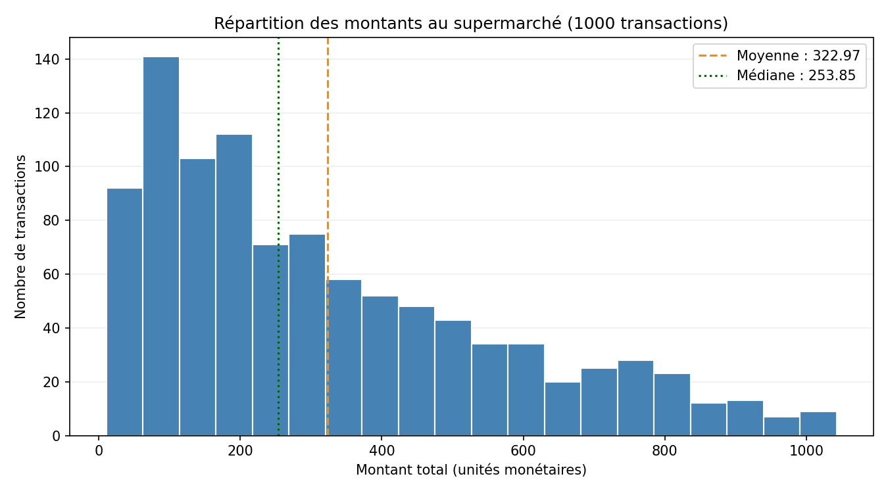

# INF1007-Projet2-Supermarche
Travail sur les bases de données

<<<<<<< HEAD
## Présentation du projet

Ce projet INF1007 consiste à développer une application Python
de prédiction de prix dans un contexte de supermarché.

L'application propose un jeu intitulé
« Devine le prix en trois essais ».

Le joueur doit retrouver un prix cible en trois tentatives maximum.

## Fonctionnalités

- Interface graphique réalisée avec Tkinter.
- Validation des données numériques et catégorielles.
- Trois tentatives maximum pour deviner le prix.
- Tolérance de 5 % autour du prix cible.
- Indices pour guider le joueur.
- Simulation avec visualisation graphique.
- Enregistrement des parties dans un fichier CSV.
- Consultation de l'historique des parties.

## État actuel du développement

Les modules de validation, de jeu et d'historique disposent
de 15 tests automatisés réussis avec pytest.

L'application utilise actuellement un prix cible temporaire
de 120 dollars.

L'intégration du modèle de prédiction développé par Davy
sera réalisée ultérieurement.

## Lancement de l'application

Ouvrir un terminal à la racine du projet.

Pour lancer l'application :

    python3 -m src.main

L'application comporte trois onglets :
- Jeu : deviner le prix en trois essais.
- Simulation : visualiser les résultats graphiquement.
- Historique : consulter les parties enregistrées.

## Tests automatisés

Les tests sont réalisés avec pytest.

Pour lancer tous les tests :

    python3 -m pytest tests/ -v

Pour tester uniquement la logique du jeu :

    python3 -m pytest tests/test_jeu.py -v

Les tests vérifient :
- La validation des variables.
- La tolérance de 5 %.
- La limite de trois essais.
- La gestion des saisies invalides.
- La sauvegarde de l'historique.
- La mise à jour des parties sans doublons.


## Installation des dépendances

Le projet nécessite Python 3 et les bibliothèques
externes indiquées dans requirements.txt.

Pour les installer :

    python3 -m pip install -r requirements.txt

L'interface utilise également Tkinter, qui doit
être disponible dans l'installation de Python.

## Organisation du projet

- src/ : code source de l'application.
- tests/ : tests automatisés avec pytest.
- README.md : documentation du projet.
- requirements.txt : bibliothèques nécessaires.
- historique_parties.csv : historique des manches.
- supermarket_sales - Sheet1.csv : données du supermarché.

=======
## Ticket mystère au supermarché

Projet de Davy et Cindy : le joueur estime le montant d'une transaction à partir
d'indices, avec la quantité cachée, puis tente de retrouver la prédiction du modèle en trois essais.
Le code de l'application n'est pas encore implémenté.

## Structure

```text
donnees/          Données et consignes sur leur provenance
modeles/          Modèle sauvegardé et métadonnées JSON à produire
src/             Code Python à développer
tests/           Tests pytest à écrire au fil du travail
graphiques/      Graphiques d'exploration sauvegardés
DECISIONS.md     Choix, justifications et validations
JOURNAL_IA.md    Usages réels de l'IA et vérifications
requirements.txt Dépendances Python
```

Le guide PDF présent dans ce dépôt décrit la répartition et les étapes.
Les fichiers .gitkeep permettent à Git de conserver les dossiers encore vides.

## Préparer l'environnement (Windows)

Depuis la racine du dépôt :

```powershell
python -m venv .venv
.\.venv\Scripts\python.exe -m pip install -r requirements.txt
```

Les commandes d'entraînement, de lancement et de test seront ajoutées quand les
modules correspondants seront disponibles. Les tests et la CI restent à créer.

## À compléter avant remise

- Source exacte et licence du jeu de données ; téléchargement ou redistribution.
- Installation vérifiée, versions utilisées et commandes de lancement.
- Structure des modules et classes, entrées et cible, préparation des données.
- Séparation entraînement/test, métrique, score et comparaison à la référence.
- Couverture réelle des tests et workflow GitHub Actions.
- Au moins trois pages de documentation officielle effectivement consultées.
- Outil du chapitre 7 utilisé et justification.
- Limites du modèle et avertissement pédagogique.

Le CSV local est ignoré par Git en attendant la confirmation de sa licence.

## Règles mises à jour : trois essais

La cible reste le total de la transaction (hypothèse du guide), pas le prix unitaire.
Le modèle calcule une seule estimation cachée par manche. Le joueur dispose de
trois propositions valides, avec un indice « plus élevé » ou « plus bas » après
chaque erreur. Une saisie invalide ne consomme pas de chance. La cible est révélée
à la victoire ou après la troisième erreur. Tolérance proposée : ±5 %, distincte
de l'incertitude du modèle. L'historique et le graphique masquent la cible active.
Le montant réel du CSV sert à évaluer le modèle, pas à déterminer la victoire.
Voir le guide mis à jour pour les détails et la répartition Davy/Cindy.

## Tests des données et exploration

Depuis la racine du dépôt, avec les dépendances installées dans votre environnement :

```powershell
python -m pytest tests/test_donnees.py -q
python -m src.exploration
```

Vérification du 14 novembre 2026 : **10 tests de données réussis** avec Python 3.14
et pytest 9.2.0. Pour cette vérification, pytest a été installé dans un dossier
temporaire hors dépôt, chargé via PYTHONPATH. Sur votre poste, installez normalement
les dépendances avec `python -m pip install -r requirements.txt` dans votre
environnement. Ce résultat ne constitue pas une mesure de couverture.

Le module `src/exploration.py` réutilise `JeuDeDonnees`, puis sauvegarde
`graphiques/exploration_total.png`. Aucune fenêtre n'est nécessaire.



L'histogramme regroupe les 1 000 montants en 20 intervalles. Les transactions de
faible montant sont plus fréquentes, tandis que quelques montants élevés allongent
la distribution vers la droite. La moyenne (322,97) dépasse la médiane (253,85).
La médiane partage les transactions en deux groupes de même taille. Ces valeurs
décrivent le CSV complet ; la future référence du modèle sera calculée seulement
sur l'ensemble d'entraînement. Aucun montant élevé n'a été supprimé sur la seule
base de ce graphique.

Notions mobilisées : fonction avec paramètres, annotations et docstring,
réutilisation d'une classe et d'un module, chemins avec `os.path.join`, création
du dossier avec `os.makedirs`, histogramme Matplotlib, légende, sauvegarde et
fermeture de la figure. La garde `if __name__ == '__main__'` évite de lancer
l'exploration lors d'un simple import. Le bloc `finally` ferme la figure même
si la sauvegarde échoue.

Documentation consultée :
- Histogramme : https://matplotlib.org/stable/api/_as_gen/matplotlib.pyplot.hist.html
- Sauvegarde : https://matplotlib.org/stable/api/_as_gen/matplotlib.pyplot.savefig.html

## Entraînement et évaluation du modèle

```powershell
python -m src.entrainer
python -m pytest -q
```

Le 14 novembre 2026, les **17 tests disponibles réussissent** (pytest installé
dans le dossier temporaire de vérification décrit plus haut). Le modèle est entraîné
avec sept entrées : prix unitaire, catégorie, type de client, succursale, paiement,
heure et jour de semaine. La cible est le total réel. Quantité, taxe, cogs et revenu
brut sont exclus : ils permettent de calculer directement le total.

Le partage `train_test_split(test_size=0.2, random_state=42)` réserve 800 lignes
à l'entraînement et 200 au test. OneHotEncoder convertit les catégories en colonnes
numériques ; ColumnTransformer laisse passer prix et heure. Prétraitement et
LinearRegression sont réunis dans une Pipeline ajustée uniquement sur le train.
Le modèle sauvegardé reste celui entraîné sur ces 800 lignes.

| Mesure sur les 200 mêmes lignes de test | Résultat |
|---|---:|
| RMSE régression linéaire, NumPy | 188,348946 |
| RMSE régression linéaire, scikit-learn | 188,348946 |
| RMSE référence DummyRegressor (moyenne du train) | 255,746440 |
| Valeur constante prédite par la référence | 319,239900 |
| Prédictions test non positives | 0 |

La RMSE baisse d'environ 26,4 % par rapport à la référence. Une RMSE plus petite
est préférable ; elle est exprimée en unités monétaires, pas en pourcentage de
précision ni en erreur absolue moyenne. La quantité inconnue fait fortement varier
le total : l'estimation reste incertaine. Le fichier ne représente que trois
succursales et trois mois en 2019, ce qui limite la généralisation. Aucun réglage
n'a été sélectionné en recherchant le meilleur score sur ce test.

Le calcul NumPy utilise `sqrt(mean((reels - predictions) ** 2))`, sans boucle.
Un test compare cette formule à une valeur calculée à la main et à scikit-learn.
Le décorateur `chronometrer` mesure le temps d'entraînement : outil du chapitre 7.

## Fichiers produits et utilisation par Cindy

- `modeles/ticket.joblib` : prétraitement et régression entraînés ensemble.
- `modeles/metadonnees.json` : variables, libellés, types, catégories et bornes
  issues uniquement du train ; métriques, graine et versions des bibliothèques.
- `modeles/separation.json` : indices des lignes train/test, disjoints.
- `modeles/manches_test.csv` : les 200 situations réservées, montant réel et
  prédiction brute. Ce fichier dérivé est ignoré par Git tant que la licence du
  CSV n'est pas confirmée. Il est recréé par l'entraînement local.

Les 200 situations de test ont été vérifiées compatibles avec les domaines des
métadonnées. L'évaluation conserve toutes les lignes, sans filtrage des erreurs.

Exemple d'appel, sans réentraînement (chemins à construire avec os dans l'interface) :

```python
from src.modele import ModeleTicket

modele = ModeleTicket()
modele.charger("modeles/ticket.joblib", "modeles/metadonnees.json")
prix = modele.predire({
    "prix_unitaire": 50.0,
    "categorie": "Food and beverages",
    "type_client": "Member",
    "succursale": "A",
    "paiement": "Cash",
    "heure": 13,
    "jour_semaine": "samedi",
})
```

Cindy lit `variables` dans le JSON pour créer les champs. Chaque objet possède
`nom`, `libelle`, `type` et soit `minimum`/`maximum`, soit `categories`.
Les types possibles sont `numerique`, `entier` et `categorielle`.
`predire` renvoie un float brut et lève ValueError pour une entrée invalide ou
une estimation non positive : l'interface affiche alors un message.
Il faut calculer une seule fois le prix au début de la manche, l'arrondir au
centime dans la logique du jeu, puis le garder secret pendant les trois essais.
Ne pas transmettre la proposition du joueur au modèle. Ne pas utiliser le total
réel pour décider de la victoire : le joueur doit retrouver le prix prédit.

Charger uniquement le joblib produit par le projet et conserver les versions
indiquées dans les métadonnées. Le score enregistré et le modèle vont ensemble ;
un nouvel entraînement réécrit les fichiers. La couverture et la CI restent à faire.
L'accord de l'auxiliaire n'est pas présumé par l'exécution de cet entraînement.

Documentation consultée :
- Encodage : https://scikit-learn.org/stable/modules/generated/sklearn.preprocessing.OneHotEncoder.html
- Sauvegarde : https://scikit-learn.org/stable/model_persistence.html
>>>>>>> origin/main
